# WordPress + MySQL avec Docker Compose, base sur stockage NFS

> Projet réalisé sur deux VM VMware pendant ma formation **Administrateur système DevOps** (titre professionnel niveau 6, M2i). Auteur : Wahid EL MAGAES.

## Résumé
Déploiement de WordPress et de MySQL dans deux containers séparés avec **Docker Compose**, sur une VM Debian 13. Les données de MySQL sont stockées sur un **partage NFS** hébergé par une seconde VM. J'ai ensuite mis WordPress à jour avec un retour arrière, limité les ressources de chaque container, puis testé la tenue de l'infrastructure après une pause et après une coupure complète des deux VM.

Résultat : la stack redémarre seule après une coupure, et les données survivent à la perte des containers comme à celle de la VM Docker.

## Contexte et problème
Il s'agit de conteneuriser une application web, de la relier au réseau et à un stockage distant, puis de la mettre à jour sans perdre le contenu du site. Faute de compte cloud, j'ai tout réalisé en local sur deux VM VMware.

## Architecture
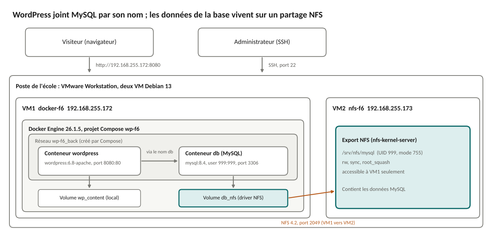

| Machine | Rôle | OS | IP |
|---|---|---|---|
| VM1 `docker-f6` | Docker, WordPress, MySQL | Debian 13, 2 vCPU, 4 Go de RAM | 192.168.255.172 |
| VM2 `nfs-f6` | Serveur NFS (données MySQL) | Debian 13, 2 vCPU, 2 Go de RAM | 192.168.255.173 |

## Technologies et versions
Docker Engine 26.1.5 et Docker Compose 2.26.1 (paquets Debian), images `wordpress:6.8-apache` et `mysql:8.4`, NFS 4.2, VMware Workstation.

## Déroulé

### 1. Préparer les deux VM
Les deux VM sont des copies d'une même VM. Je change pour chacune le nom d'hôte, le Machine ID et les clés SSH, sinon elles ont la même identité.
```bash
hostnamectl set-hostname docker-f6
rm -f /etc/machine-id /var/lib/dbus/machine-id && dbus-uuidgen --ensure=/etc/machine-id && ln -s /etc/machine-id /var/lib/dbus/machine-id
rm /etc/ssh/ssh_host_* && dpkg-reconfigure openssh-server
```

### 2. Installer Docker
```bash
apt install -y docker.io docker-compose
docker --version && docker compose version && docker run --rm hello-world
```
Choix : les paquets Debian sont plus simples à maintenir que le dépôt officiel Docker, au prix de versions un peu moins récentes.

### 3. Écrire la stack
Les mots de passe sont générés au hasard et placés dans un fichier `.env` (droits 600), hors du fichier Compose, avec les versions d'images. Voir [`configs/docker-compose.yml`](configs/docker-compose.yml) et [`configs/.env.example`](configs/.env.example).
```bash
printf 'MYSQL_ROOT_PASSWORD=%s\n...' "$(openssl rand -hex 16)" > .env && chmod 600 .env
docker compose config -q      # valide le fichier
docker compose up -d && docker compose ps
```
Points de conception : un service par container, `healthcheck` sur MySQL avec `depends_on: condition: service_healthy` pour que WordPress attende la base, `restart: unless-stopped`, limites `mem_limit` et `cpus`, réseau dédié où WordPress joint la base par le nom `db`.

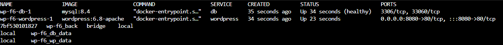

### 4. Tests de base
- **Article publié** : l'installation de WordPress est faite dans le navigateur ; l'article s'affiche. 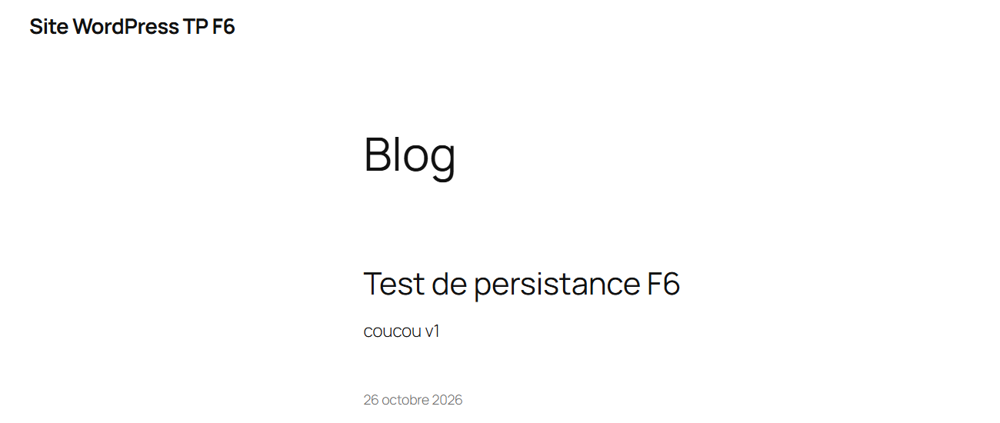
- **Base arrêtée** (`docker stop`) : WordPress reste `Up` et affiche une erreur de connexion, il dépend donc de MySQL par le réseau. 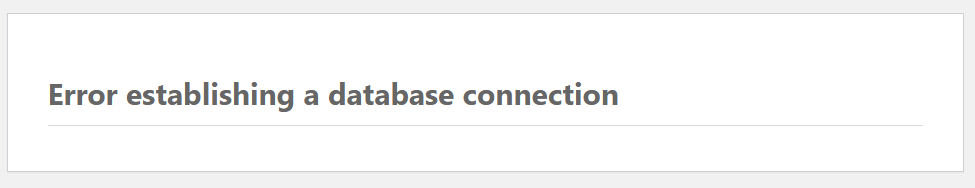
- **`docker compose down` puis `up -d`** (sans `-v`) : l'article est toujours là, les données sont dans les volumes. 

### 5. Mise à jour de WordPress et retour arrière
Sauvegarde, changement du tag, puis remplacement des containers :
```bash
docker compose exec -T db sh -c 'mysqldump -uroot -p"$MYSQL_ROOT_PASSWORD" wordpress' > backup_avant_maj.sql
sed -i 's/^WP_TAG=.*/WP_TAG=6.9-apache/' .env
docker compose pull wordpress && docker compose up -d
```
Après correction (incident 1), WordPress est en 6.9.4. 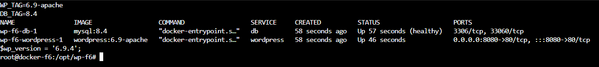

WordPress s'étant mis à jour seul en 7.1.3 (incident 2), je reviens en 6.8 : retour du tag **et** restauration de la sauvegarde, car changer seulement le tag ne suffit pas quand la base est déjà migrée.
```bash
sed -i 's/^WP_TAG=.*/WP_TAG=6.8-apache/' .env
docker compose down && docker compose up -d -V
docker compose exec -T db sh -c 'mysql -uroot -p"$MYSQL_ROOT_PASSWORD" wordpress' < backup_avant_maj.sql
```
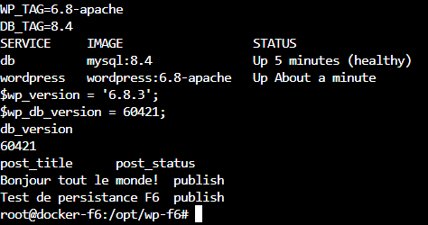

### 6. Stockage distant NFS
Sur VM2, je partage un dossier avec VM1 seulement, en gardant `root_squash` :
```bash
apt install -y nfs-kernel-server
mkdir -p /srv/nfs/mysql && chown 999:999 /srv/nfs/mysql && chmod 755 /srv/nfs/mysql
echo '/srv/nfs/mysql 192.168.255.172(rw,sync,no_subtree_check)' >> /etc/exports
exportfs -ra && exportfs -v
```
Sur VM1, `apt install -y nfs-common`, puis un volume Docker de type `nfs` monté sur `/var/lib/mysql` (voir le compose) et la restauration de la base. `df -hT` indique `nfs4`, et les fichiers de la base sont bien sur VM2 : 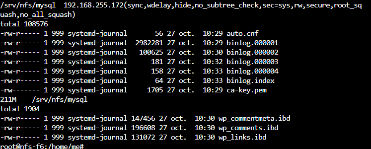

### 7. Ressources
`docker stats --no-stream` : MySQL utilisait 439 Mio sur 512 Mio (85,75 %), trop juste. Je passe sa limite à 1 Go (41,64 %). 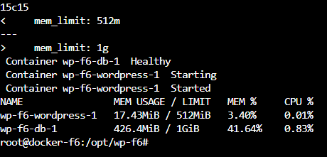

### 8. Pause, coupure et redémarrage
- `docker compose pause` : les containers sont `Paused` et le site ne répond plus ; après `unpause`, la base redevient `healthy` en quelques secondes. 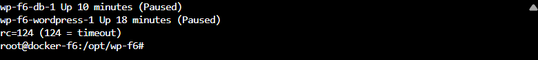 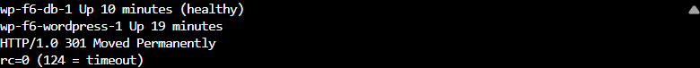
- Après une coupure complète, WordPress repart mais pas la base (incident 4). Correctif sur VM1 :
```bash
cp /etc/network/interfaces /etc/network/interfaces.bak
sed -i 's/^allow-hotplug ens33/auto ens33/' /etc/network/interfaces
systemctl enable ifupdown-wait-online.service
```
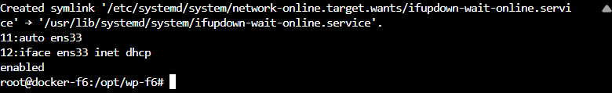
- Redémarrage simultané des deux VM : la base est `healthy` sans intervention, sans redémarrage de container, et les articles sont toujours affichés. 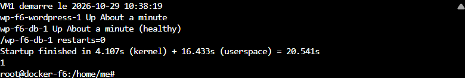 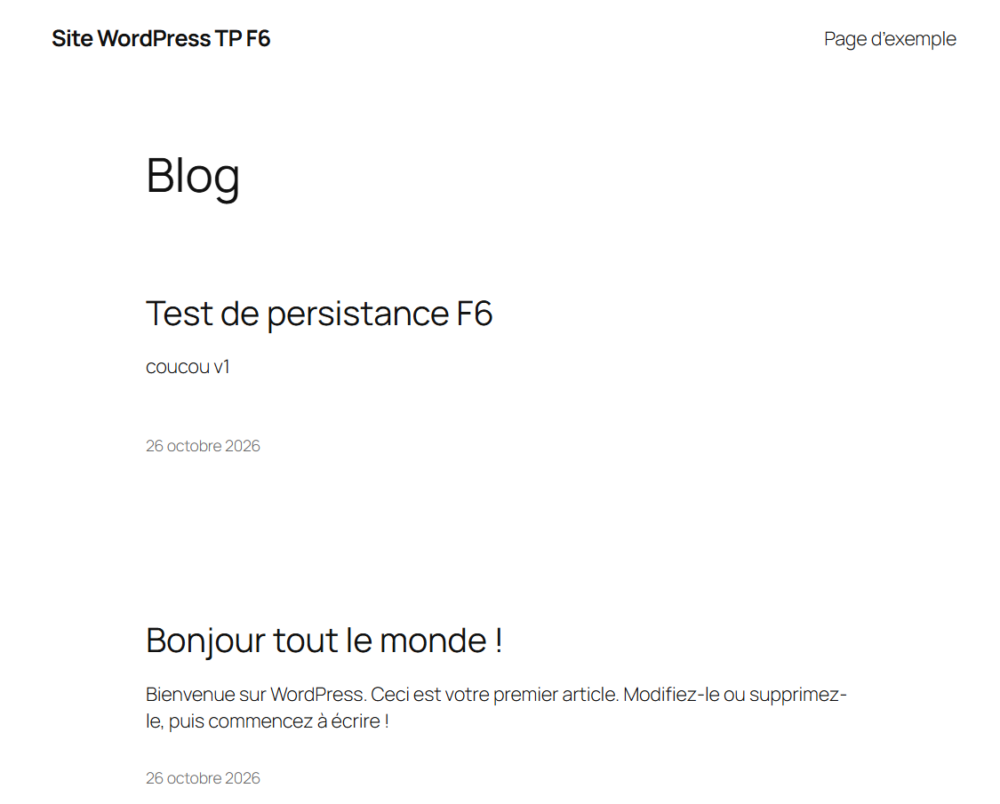

## Problèmes rencontrés

| N° | Symptôme | Cause | Correction |
|---|---|---|---|
| 1 | Après le changement de tag, WordPress reste en 6.8.3 | Tout `/var/www/html` était dans un volume : l'image ne pouvait pas remplacer le code | Volume limité à `wp-content`, puis `down` et `up -d` |
| 2 | WordPress passe seul en 7.1.3 et migre la base | Mise à jour automatique du cœur, faite dans le container et non dans l'image | Retour arrière, puis `WP_AUTO_UPDATE_CORE` à `false` : une mise à jour passe par le tag |
| 3 | NFS : « permission denied », puis « operation not permitted », puis `db` redémarre en boucle | `root_squash` transforme le root de VM1 en `nobody` : le container ne peut ni lire le dossier ni copier les droits | `chmod 755`, option `:nocopy`, `user: "999:999"` sur `db` ; `root_squash` conservé |
| 4 | Après une coupure complète, WordPress repart mais `db` reste `Exited (255)` | Docker lance `db` avant que la carte réseau ait son adresse : le montage NFS échoue et Docker ne retente pas | `auto ens33` à la place de `allow-hotplug` et `ifupdown-wait-online` activé |

## Pistes pour la production
- **Disque** : CPU et mémoire sont limités par container, pas l'espace disque.
- **Stockage** : le NFS est un point unique de défaillance et n'est pas chiffré ; prévoir un stockage répliqué.
- **Sauvegardes et secrets** : sauvegardes à automatiser ; mots de passe dans Docker secrets ou un coffre-fort plutôt que dans `.env`.
- **Accès** : le groupe `docker` équivaut à root ; site en HTTP, à placer derrière un reverse proxy HTTPS.
- **Démarrage** : si VM2 est indisponible quand VM1 démarre, `db` échoue encore ; utiliser une unité `systemd` avec relance ou un orchestrateur.

## Reproduire
1. Deux VM Debian 13 avec les adresses du tableau (ou adapter les IP dans le compose et `/etc/exports`).
2. Suivre les étapes 2, 6 puis 3 : Docker, partage NFS sur VM2, copie de `configs/` dans `/opt/wp-f6`, création du `.env` depuis `.env.example`.
3. `docker compose up -d`, puis ouvrir `http://<IP VM1>:8080`.
